# A Fake jli.dll, a Hidden Rust Payload and 500 Encrypted Strings — Unpacking a Java Side-Loading Infostealer

This sample came with an `.exe` extension, but it isn't an executable. It's a 64-bit DLL that pretends to be `jli.dll`, a library that ships with every Java runtime. Drop it next to a real, signed `java.exe` and Java loads it for you. Inside there are two stages: a loader full of control-flow flattening, and a second PE that only ever exists in memory. Every interesting string in both of them is encrypted, one by one, each with its own key.

Unlike my previous writeups, this one is not purely static. The flattening made it impractical to follow the code by hand, so after a first static pass I moved to a lab VM and a debugger. That's how I found the second stage in memory and dumped it. After that I went back to static work: I reversed the string decoder, rewrote it in Python, decoded the strings of both stages and wrote some capa rules to summarise what the payload is built to steal.

A note on tools: I used Claude, an LLM by Anthropic, to help write the scripts in this analysis (the Python decoder, the string extractor, the patching scripts and the capa rules). Every result they produced was checked against what I saw in the debugger or in the emulator.

## Triage

```
$ sha256sum f167da5d...9875.exe
f167da5dab47670aac7271d514353f8ca5d6bd9a769116926aaad188eb499875

$ file f167da5d...9875.exe
PE32+ executable for MS Windows 6.00 (DLL), x86-64, 6 sections
```

So, a DLL with an `.exe` name. The exports tell you right away what it wants to be:

```
$ rabin2 -E f167da5d...9875.exe
JLI_CmdToArgs  JLI_GetStdArgc  JLI_GetStdArgs  JLI_InitArgProcessing
JLI_Launch     JLI_MemAlloc    JLI_MemFree     (+ the same functions as ordinals 8-14)
```

`JLI` is the Java Launcher Interface. `java.exe` itself is a small program: the real work starts in `jli.dll`, which sits in the same `bin` folder and exports exactly these functions. The export directory of the sample even keeps its original internal name, `loader.dll`.

Other things I noted during triage:

- **Very few imports**: `kernel32` only, with `LoadLibraryA` and `GetProcAddress` among them, plus `WaitOnAddress` / `WakeByAddressAll`. When a binary imports almost nothing but `LoadLibraryA` and `GetProcAddress`, it resolves the rest at runtime, with names it doesn't want you to see.
- **Large blobs of base64-looking text** in `.rdata` and `.data`.
- The code looks like Rust: buffers handled as `{ptr, capacity, length}` triples (Rust's `Vec`) and one-time initialisation built on `WaitOnAddress`/`WakeByAddressAll` (that's how Rust's `Once` works on Windows). There are no `.rs` paths or panic messages in the file.
- Compile timestamp: `2026-11-18 17:56:24 UTC`.

## Why jli.dll: DLL side-loading

When Windows loads a DLL by name, it looks in the folder of the executable first. `java.exe` imports `jli.dll` by name. So if you place a malicious `jli.dll` next to a legitimate, signed `java.exe` and start it, the signed binary runs the attacker's code. This is DLL side-loading, and the process that shows up in the logs is just `java.exe`.

That also told me how to run the sample later: not by double-clicking it (a DLL doesn't run by itself), but the way it was meant to run.

## First static pass: the flattening

Opening the DLL in Ghidra didn't get me far. The decompiler showed almost nothing of the author's code, because the code isn't made of normal functions and branches. Every block ends with a jump through a register:

```
cmp    rax, rdi
lea    rcx, [0x1800599b4]
lea    rdx, [0x180059abc]
cmova  rdx, rcx          ; pick one of two table entries
movsxd rcx, dword [rdx]  ; read a 32-bit signed offset
add    rcx, r14          ; r14 = 0x180002b27, a fixed base
jmp    rcx
```

This is **control-flow flattening**. The real flow is hidden in tables of offsets, and the next block depends on a comparison and a `cmov`. Some of those comparisons always go the same way, and the other side ends in `ud2` (an instruction that crashes on purpose). Those are **opaque predicates**: fake branches added to make the graph bigger. A linear disassembly with objdump and r2 worked much better than Ghidra here.

Instead of reading the main function from the top, I started from `LoadLibraryA` and walked backwards:

| Address | What it is |
|---|---|
| `0x180001e64` | `call LoadLibraryA`, with the DLL name in `rcx` |
| `0x180007f00` | allocates a buffer and copies a string into it, returning `{ptr, cap, len}` — I called it `clone_buffer` |
| `0x1800186cf` | checks a state field with `lock cmpxchg` and only does the work the first time — a lazy initialiser |
| `0x1800088b5` | called only by the lazy initialiser — the string decoder |

So the pattern was: every hidden string has a global "cell". The first time it's needed, the lazy initialiser decodes it into the cell. After that, the code just copies it from the cell. There are 21 such strings in this stage.

To understand the decoder I needed to know what goes into it, and that's where static analysis got stuck. The input was built on the stack, in slots that many flattened blocks reuse for different things. Following which block writes what, by hand, through hundreds of table jumps, wasn't realistic. Time for a debugger.

## The lab

For the dynamic part I used a Windows 11 VM under QEMU/KVM with FLARE-VM, on an isolated network (no internet, traffic captured on the host). Inside the VM:

- **FakeNet-NG** to answer and log any network connection,
- **Process Monitor**,
- **Regshot**, plus small PowerShell scripts that save processes, connections, services, scheduled tasks, files, registry and autoruns before and after the run, and then diff them,
- **x64dbg** with **ScyllaHide**,
- the **Eclipse Temurin 21 JRE**. I copied the JRE folder, renamed the real `bin\jli.dll` to `jli_orig.dll` and put the sample in its place as `bin\jli.dll`.

## First run, without a debugger

I took the "before" snapshots, started FakeNet and Procmon, and ran `java.exe`. A message box appeared:


*Window title `yolo`. The author talks directly to the analyst, says "Yara sucks" and names a YARA rule, `VIGIA_WARDENStealer_8f4ac3a9`, complaining that it matches on the Rust standard library. That rule name is why I call this family **WardenStealer** in this writeup.*

After clicking OK, nothing else happened.

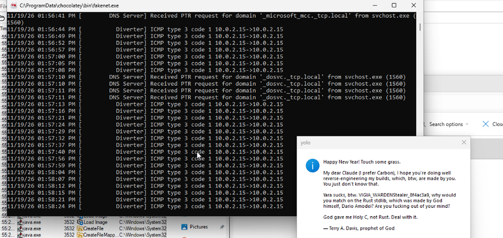
*FakeNet saw PTR lookups from `svchost.exe` and ICMP noise. Nothing from `java.exe`.*

The before/after diff confirmed it. Most of what changed was my own tools: FakeNet unpacks itself into `%TEMP%\_MEI*` (it's a PyInstaller program) and installs the WinDivert driver, and the JRE folder I copied shows up as new files. There were no files, services, scheduled tasks or autoruns created by the sample, no connections, and `java.exe` was no longer running at the end.

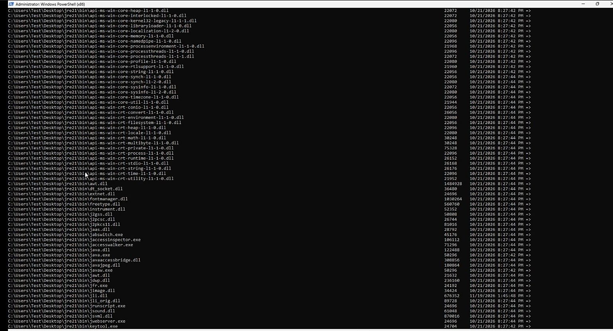
*`jli.dll` (676 352 bytes) is the sample; `jli_orig.dll` (89 728 bytes) is the real Java DLL.*

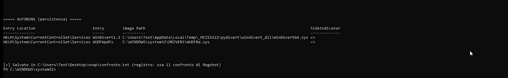

So in my VM the sample showed a message and exited. To see why, I needed to see it from the inside.

## Into x64dbg

### Finding the DLL in memory

The breakpoints I wanted were in `jli.dll`, but a DLL is not loaded at its preferred address (`0x180000000`) because of ASLR. Everything inside it moves by the same amount, so an address inside the DLL is always `base + RVA`, where the RVA is the distance from the start of the module. x64dbg stops on the sample's **TLS callback** (code that runs even before `DllMain`), and that gave me the base right away:

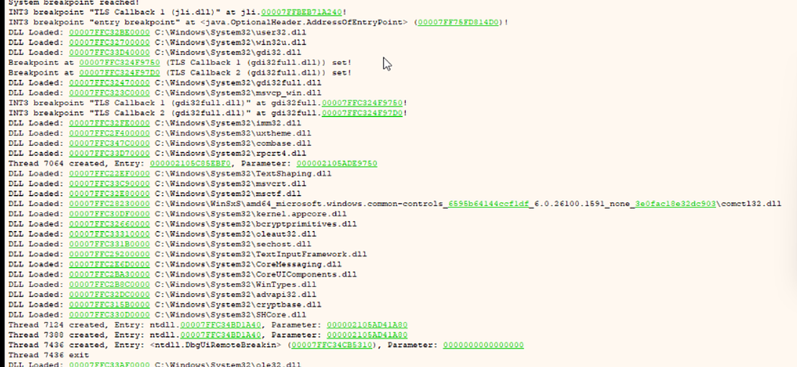
*The TLS callback is at RVA `0xA240`. Its address in memory minus `0xA240` is the base of `jli.dll`.*

The base changed between runs, so I got used to reading it from the Memory Map every time:

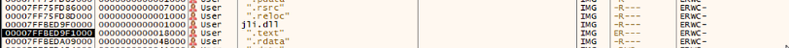

### The first decoded string

With a breakpoint on the lazy initialiser (base + `0x186CF`), the inputs were finally visible:

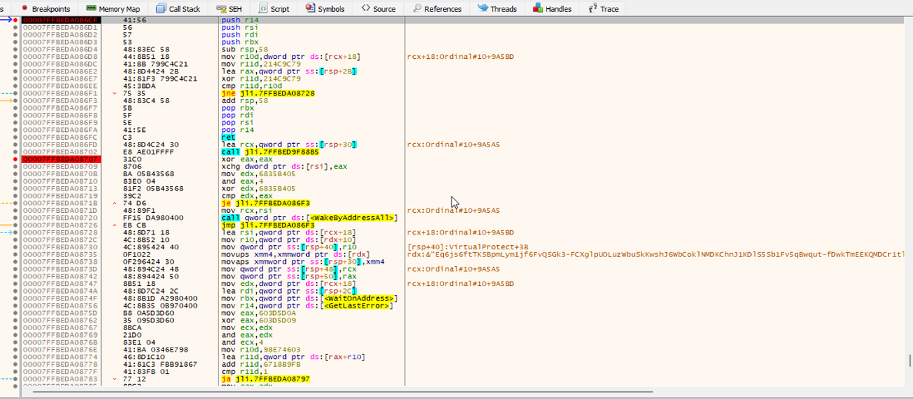
*It reads a state field at `[rcx+0x18]`. If the string was already decoded it returns. Otherwise it calls the decoder at RVA `0x88B5`.*

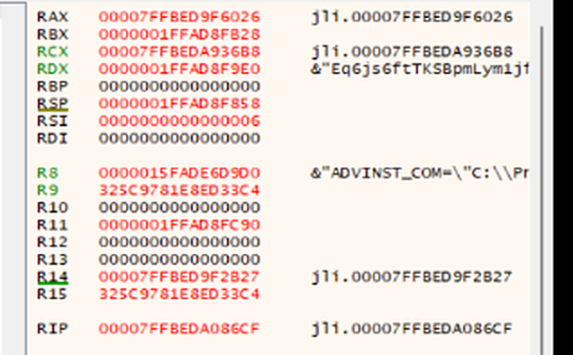
*`rcx` is the cell, in `.data` (RVA `0xA36B8`). `rdx` points to a small structure on the stack.*

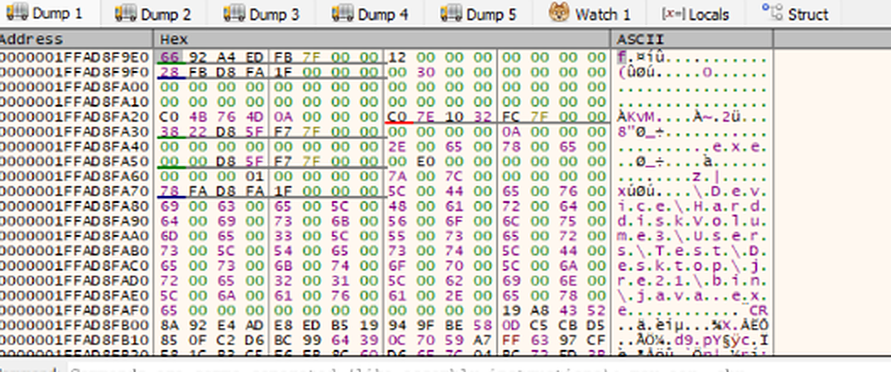
*First field: a pointer into `.rdata` (RVA `0x59266`), to the encoded text. Second: `0x12`, its length (18 characters). Third: a pointer to a 64-bit value.*

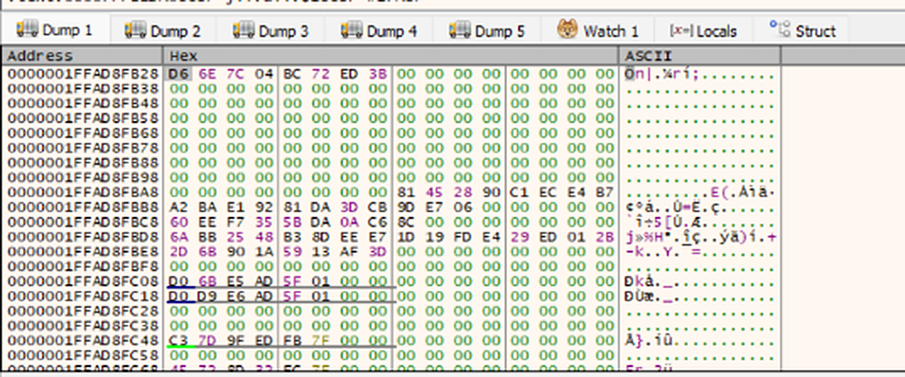
*`0x3BED72BC047C6ED6`: not an address, not text. As we'll see, it's the key (I call it the seed) for this one string.*

After the decoder returned, the cell held a Rust string: pointer, capacity 11, length 11, and the state field set to 1.

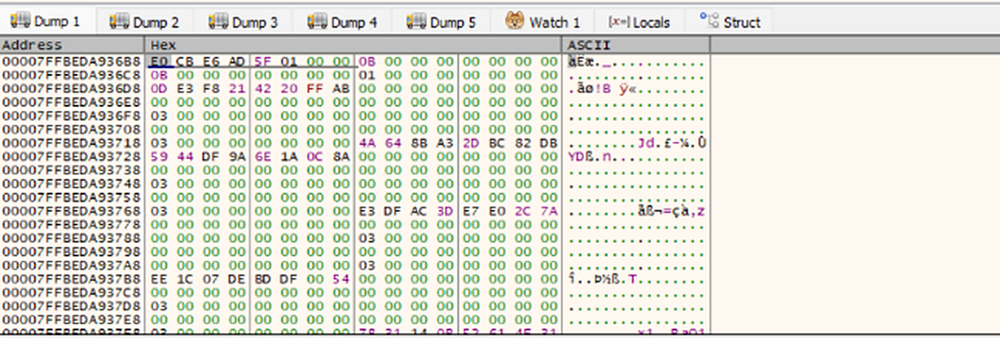

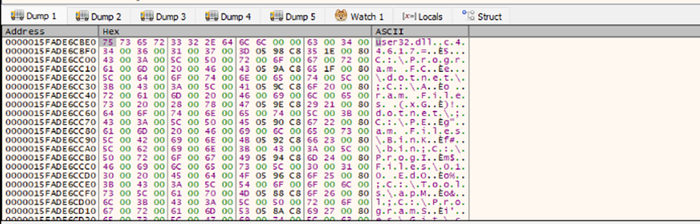
*`user32.dll\0`, 11 bytes. The rest of the dump is unrelated heap data (the `PATH` environment variable).*

The next stop was a second `LoadLibraryA` call site at RVA `0x6149`, with a **copy** of the same string (a different heap address, made by `clone_buffer`):

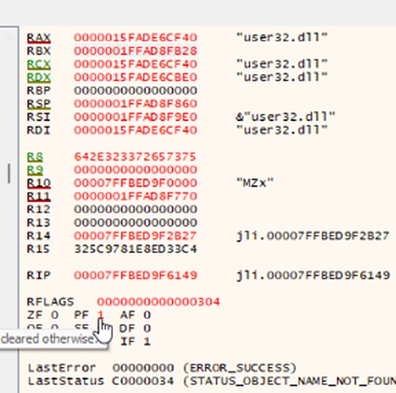

### Logging every API it resolves

Stepping through every string would have taken forever, so I turned the breakpoints on `GetProcAddress` and `LoadLibraryA` into logging breakpoints (log the name, never stop) and added real breakpoints on `MessageBoxW`, `MessageBoxA` and `ExitProcess`. Then I let it run:

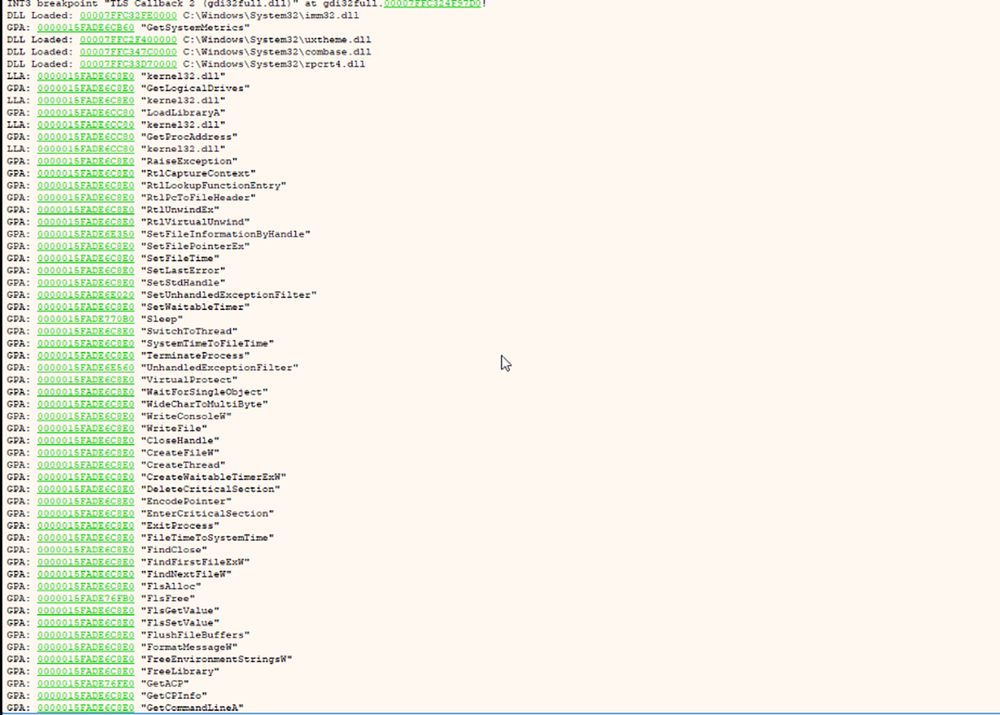
*The first names it resolves are `GetSystemMetrics` and `GetLogicalDrives`. Then it resolves `LoadLibraryA` and `GetProcAddress` for itself, and then a long list of kernel32 functions…*

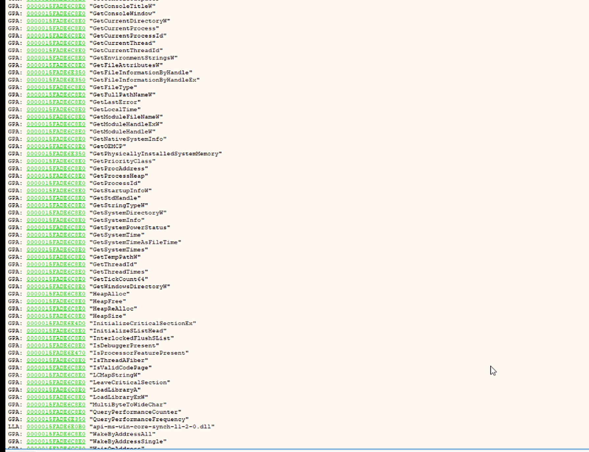
*…in alphabetical order, about a hundred of them, many of them typical C runtime imports (`FlsAlloc`, `GetCPInfo`, `LCMapStringW`, `HeapAlloc`…). That's what an import table looks like, and nothing in stage 1 needs all of these.*

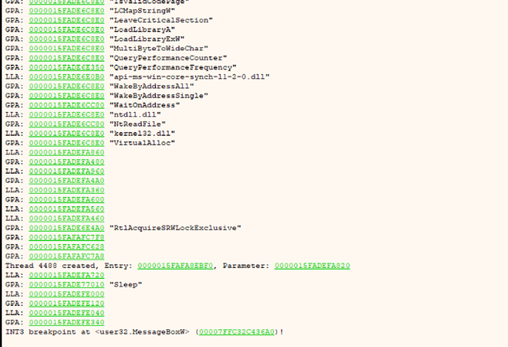
*Then `NtReadFile` from ntdll, `VirtualAlloc`, a few calls where the log shows no name, a new thread whose entry point (`0x15FAFA8EBF0`) is not inside any module, `Sleep`, and finally the stop on `MessageBoxW`.*

## Stage 2, sitting in memory

The call stack at `MessageBoxW` answered most of my questions:

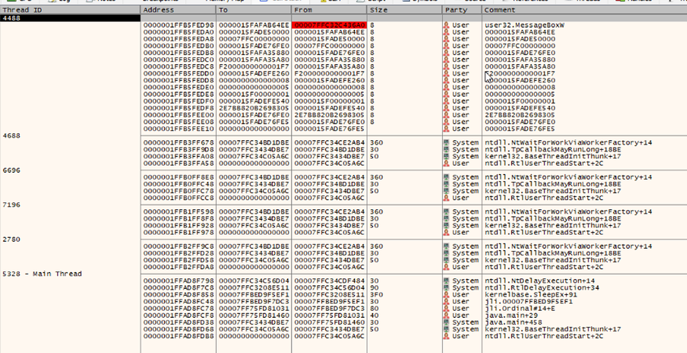
*Thread 4488 calls `MessageBoxW` from `0x15FAFAB64EE`, an address that belongs to no module. The main thread is inside `jli.dll`, sleeping in `SleepEx`.*

So the message box doesn't come from the code I had been reading. It comes from a new thread running code that is not part of any module, while the main thread sleeps inside `jli.dll`. The Memory Map showed what that code was:

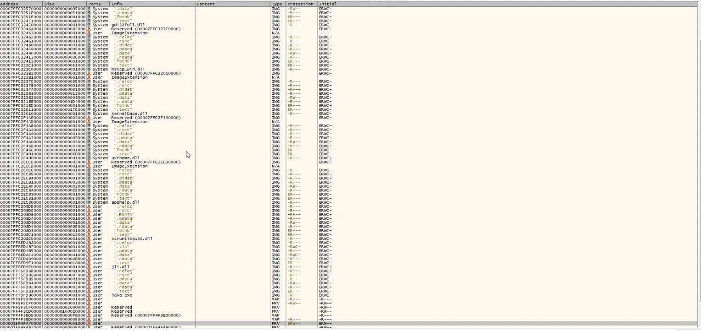
*Region at `0x15FAFA70000`, size `0xA1000`, type `PRV` (private memory, no file behind it), protection `ERW` (read, write and execute). Both the thread entry (+`0x1EBF0`) and the `MessageBoxW` caller (+`0x464EE`) are inside it.*

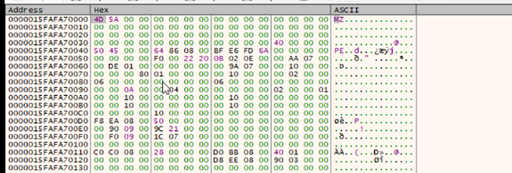
*`MZ` with the DOS stub zeroed, `PE` at +`0x40`, machine `0x8664` (x64), 8 sections, characteristics `0x2022` (a DLL), optional header magic `0x20B` (PE32+).*

A complete PE file, mapped by hand into executable private memory. Its code and headers are already in clear text: the only things still encrypted are its strings, which it decodes one by one when it needs them, with the same scheme as stage 1. So a memory dump at this point gives you the whole payload, ready for a disassembler. I saved the raw region from x64dbg and also ran **pe-sieve**, which finds implanted PEs and rebuilds their headers and imports:

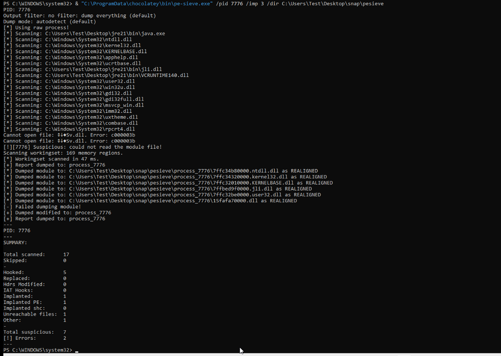
*"Implanted PE: 1", dumped as `15fafa70000.dll`. The "hooked" modules are expected here: ScyllaHide patches ntdll, kernel32, kernelbase and user32, and my software breakpoints patch `jli.dll`. pe-sieve also reported a module in the loader list with an unreadable name and no file behind it.*

```
stage 2 (pe-sieve, realigned)   c47f0cb5a0c51d908fbcc38be70ade963762e4f4adca8fb32f33440cb9af4376
sections: .text .rdata .data .pdata .fptable .tls _RDATA .reloc
compile timestamp: 2026-11-18 17:56:15 UTC (9 seconds before stage 1)
```

### Checking it a second way: emulating stage 1

To be sure that this region is what stage 1 produces, and not something changed at runtime, I also ran stage 1 in an emulator (Unicorn, on the host, never on a real Windows). The emulated run decodes the same 21 strings, calls `VirtualAlloc(0, 0xA0400, MEM_COMMIT | MEM_RESERVE, PAGE_EXECUTE_READWRITE)`, writes a PE into it and ends in `Sleep(INFINITE)`. Compared with the memory dump from the VM, the `.text` section is identical byte for byte. The other sections differ only where addresses are stored, which depend on where each copy was loaded.

## The string decoder

Stage 2 hides its strings the same way stage 1 does, but at a much bigger scale. It also uses them to resolve APIs lazily. Here is one API call, cleaned up:

```
mov   rbx, [cell_api]        ; cached pointer, 0 the first time
cmp   ...                    ; is it filled? (hidden behind arithmetic)
...   ; first time only:
lea   rax, [encoded_name]    ; struct {text, length, &seed}
call  lazy_init              ; decode the name once into its own cell
call  clone_buffer           ; copy it
call  [GetProcAddress]       ; resolve by name
mov   rbx, rax
call  free                   ; free the copy of the name
mov   [cell_api], rbx        ; cache the pointer
...
call  rbx                    ; the actual API call
```

Two things follow from this. API names are in clear text in memory only for a moment. And a cell that is not zero in a memory dump means that API was already resolved and called. My dump was taken while the message box was open, and the cell for `GetSystemFirmwareTable` was filled: the firmware check had already run before the message box appeared.

The lazy initialiser in stage 2 (offset `0x7AFC4`) is Rust's `Once`: a state machine with `lock cmpxchg`, `WaitOnAddress` for threads that arrive while another one is decoding, and `WakeByAddressAll` when it's done. The work itself is called through a function table, at `[vtable + 0x20]`. Following that pointer led to the decoder, at offset `0x4FAC8`. It turned out to be the **same algorithm as in stage 1**, with the same constants. It has three layers.

**1. Base64 with a secret alphabet.** The 64 symbols are `_ - 9…0 z…a Z…A` (URL-safe base64, in reverse). They get shuffled with Fisher-Yates, and the random numbers come from SplitMix64. The author added two XORs to the standard version:

```python
M = (1 << 64) - 1
GAMMA = 0x9E3779B97F4A7C15

def mix(z):                                   # SplitMix64 finaliser
    z = ((z ^ (z >> 30)) * 0xBF58476D1CE4E5B9) & M
    z = ((z ^ (z >> 27)) * 0x94D049BB133111EB) & M
    return z ^ (z >> 31)

state = mix((seed ^ 0x3B42D70742E7AF28) + GAMMA & M) ^ 0x3CC84BD037093D
s = ((state ^ 0xE7037ED1A0B428DB) + GAMMA) & M
for i in range(63, 0, -1):                    # Fisher-Yates
    j = mix(s) % (i + 1)
    alphabet[i], alphabet[j] = alphabet[j], alphabet[i]
    s = (s + GAMMA) & M
```

Every string has its own seed, so every string has its own alphabet. The text is then decoded 6 bits per character, as in normal base64.

**2. XOR with a keystream.** The bytes are XORed with numbers from a 64-bit linear congruential generator, again started from the seed. A new number every 8 bytes, used from the highest byte to the lowest:

```python
x = seed ^ 0x58A5AD87A4A04400
s = (x * 0x1F6818A70B374537 + 0x183DBDA06EAB4239) & M if x else 0xA6822743F903F40A
for i in range(len(data)):
    if i % 8 == 0:
        s = (s * 0x1F6818A70B374537 + 0x183DBDA06EAB4239) & M
        t = ((s ^ (s >> 24)) * 0xD0E1CA4E8334DFE9) & M
        k = t ^ (t >> 31)
    data[i] ^= (k >> (56 - 8 * (i % 8))) & 0xFF
```

**3. A small LZ compressor, read bit by bit.** The bits are read from the lowest bit of each byte. First comes a header: one bit says whether the data is compressed, two bits give the size of the length field (8, 16, 24 or 32 bits), then the output length. Then a sequence of tokens: `0` + 8 bits is a literal byte, and `1` + distance + length means "copy *length* bytes from *distance* bytes back". The distance field is 4 to 15 bits wide depending on the output size, and the length is 5 bits plus 2, with an escape for longer matches (extra bytes added while they are `0xFF`). It belongs to the same family as LZSS, but the format is the author's own.

With the inputs I had seen in x64dbg (text at RVA `0x59266`, 18 characters, seed `0x3BED72BC047C6ED6`), my Python version gives `user32.dll\0`. I also checked each layer against the real decoder, running the payload's own function on the same input in Unicorn: the shuffled alphabet and the bytes after the XOR were identical.

None of this is strong crypto. Every key is in the binary. But no string ever appears in clear, there is no single key to look for, and a string is only decoded the first time it's used.

### Decoding everything

To decode all the strings I wrote a script that goes through the code and, for each `lea` that points to base64-like text in `.rdata`, tries the 64-bit constants loaded nearby (`movabs`) as the seed. A wrong seed gives a nonsense header with a huge output length, so most wrong guesses are thrown away after a dozen characters. The real length isn't needed either: the header says how many bytes to produce.

- **Stage 1**: all 21 strings. For 17 of them the seed is a plain 64-bit constant in the code. The other 4 are split on purpose, for example `seed = r15 + 0x1A52DF4EB30C5C27 + [rsp+0x388]`, so the value only exists at runtime. The emulator gave me those.
- **Stage 2**: about 480 strings. I dropped the results that were only one or two characters long and didn't look right, because with so little data a wrong seed can pass the header check by luck.

Between the encoded strings there are also about thirty runs of plain English words, many of them random, such as *"find live we three different two mother can then before as"*. They are not used as strings by the code. If you run `strings` on the payload, that is the readable text you get.

## The C2

The only domain among the decoded strings is **`phigerma.quest`**. It's decoded in the same big function that holds the virtual machine checks (offset `0x151F8`), and then passed to the function at offset `0x2FBA3`. That function resolves the WinHTTP API by name: `WinHttpOpen`, `WinHttpSetTimeouts`, `WinHttpOpenRequest`, `WinHttpSendRequest`, `WinHttpReceiveResponse`, `WinHttpQueryHeaders`, `WinHttpReadData`, `WinHttpWriteData`, `WinHttpSetOption`, `WinHttpCloseHandle`.

Inside it, two calls give away the connection settings:

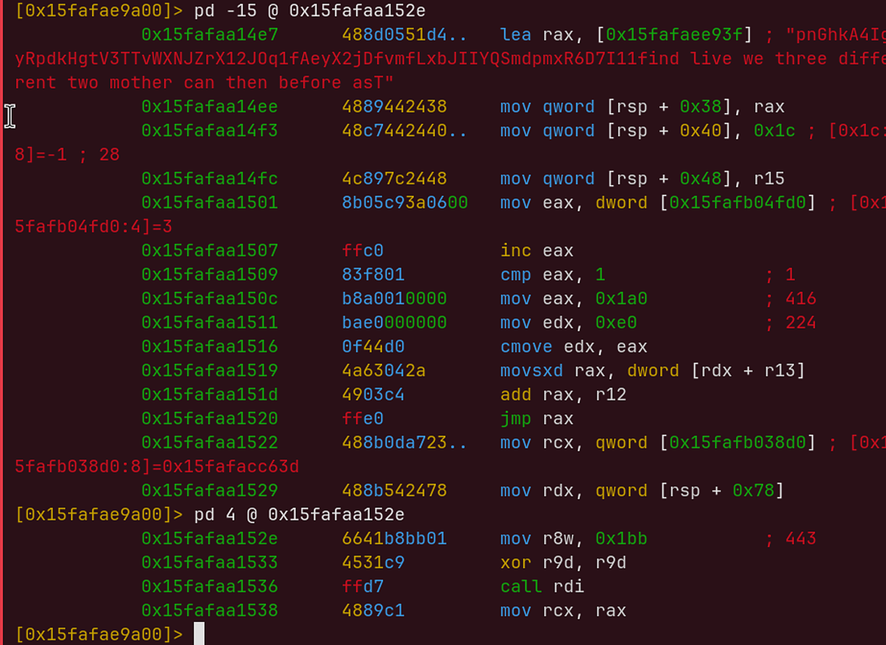
*`rcx` = session handle, `rdx` = server name, `r8w` = `0x1BB` (**443**), `r9d` = 0.*

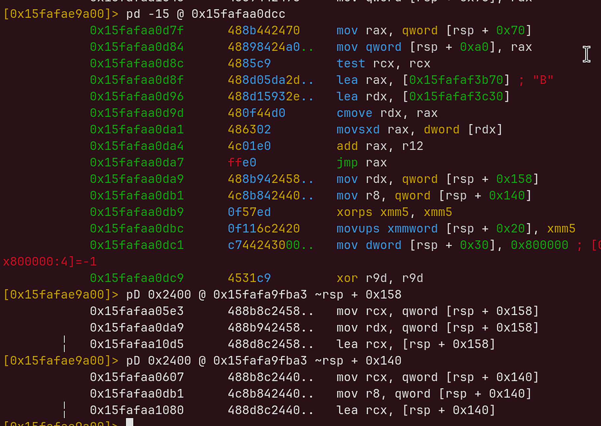
*`0x800000` is `WINHTTP_FLAG_SECURE`: the request goes over **HTTPS**.*

A public search for the domain links it to infostealer samples on MalwareBazaar and Joe Sandbox that use the same `jli.dll` side-loading.

## What the payload is built to steal

With the strings decoded, it's clear what kind of program stage 2 is. Below is what the strings show, grouped by area of the code. These are strings and API names found in the binary. I did not trace every one of these features in the code.

- **VM and analysis checks** (all in the function at `0x151F8`): `GetSystemFirmwareTable`; `SYSTEM\CurrentControlSet\Enum\PCI` with `VEN_1AF4` and `VEN_1B36` (Red Hat virtio and QEMU PCI vendor IDs); `EnumDisplayDevicesW` with `Virtio`, `Standard VGA`, `Basic Display`; `GlobalMemoryStatusEx`; `GetSystemMetrics`; `GetVolumeInformationW`; the `Uninstall` registry key; `Keyboard Layout\Preload`; `RtlGetVersion`. Elsewhere there's a list of hypervisor vendor strings, the kind returned by `CPUID`: `VBoxVBoxVBox`, `XenVMMXenVMM`, ` prl hyperv `, `HAXMHAXMHAXM`, `LKVMLKVMLKVM`, `OpenBSDVMM58`, `Apple VZ`, `bhyve bhyve `… The message box text is decoded in the same function as these checks, and the `GetSystemFirmwareTable` cell was already filled in the dump taken while the message box was on screen, so the firmware check ran before the payload gave up.
- **Screenshots**: `GetDC`, `CreateCompatibleDC`, `CreateCompatibleBitmap`, `BitBlt`, `GetDIBits` and a `BM` header.
- **Chromium browsers**: `Local State`, `encrypted_key`, `app_bound_encrypted_key`, `Login Data`, `Web Data`, `History`, `Local Storage\leveldb`. For browser extensions (where wallet extensions keep their data) the strings include `\Extensions`, `\Local Extension Settings`, `manifest.json`, `_locales` and `messages.json`. For decryption: `CryptUnprotectData` (DPAPI) and `BCryptDecrypt` with `ChainingModeGCM` (AES-GCM). In the same area as `app_bound_encrypted_key` there are `CreateDesktopA`, `CloseDesktop`, `CreateToolhelp32Snapshot` and `CryptUnprotectMemory`.
- **Firefox**: `key4.db`, `logins.json`, `cookies.sqlite`, `formhistory.sqlite`, `places.sqlite`, `prefs.js`.
- **Files locked by other processes**: `NtQuerySystemInformation`, `NtQueryObject`, `DuplicateHandle`, `QueryDosDeviceW`, `MapViewOfFile`.
- **Crypto clipboard**: `OpenClipboard`, `GetClipboardData`, `EmptyClipboard`, `SetClipboardData`, next to address prefixes `bc1`, `ltc1`, `bitcoincash:`, `addr1`, `EQ`, `UQ`. The attacker's replacement addresses are not among the decoded strings, so they evidently come from the C2.
- **Games and chat**: Steam (`Software\Valve\Steam`, `config\config.vdf`, `Steam\local.vdf`, `ConnectCache`), Discord (`discord`, `dQw4w9WgXcQ:`, the prefix of Discord's encrypted tokens), Roblox (`.ROBLOSECURITY`, `RobloxCookies.dat`).
- **Download and run**: `curl.exe -fs -o`, `certutil.exe -urlcache -split`, `cmd.exe`, `powershell.exe -ex bypass -File`, `msiexec.exe /qn /norestart`, with `.exe`, `.bat`, `.cmd`, `.ps1` and `.msi` extensions.

## capa

I installed capa (10.0.0) with the official rules and ran it on the dumped payload. To give it a chance, I first wrote a copy of the payload with all the decoded strings put back in place of the encoded text. The result was thin: anti-VM strings for VirtualBox, Parallels and Xen, analysis tool names, environment variables, file listing and writing, process termination and PE parsing. Most rules need to see a call to an API, and here every call is `call rbx` after a lookup in the cache, in a different block than the one that loads the pointer. The flattening also splits the functions, so the indicators a rule needs never end up in the same function. Adding the cache cells to the import table, which I also tried, didn't change the result.

So I wrote my own rules: 17 file-level capa rules based on the decoded strings, plus one that recognises the decoder by its constants. To be clear, these rules are mine. They summarise what is written above and are not an independent detection by capa. They are the ones under the `wardenstealer/` namespace:

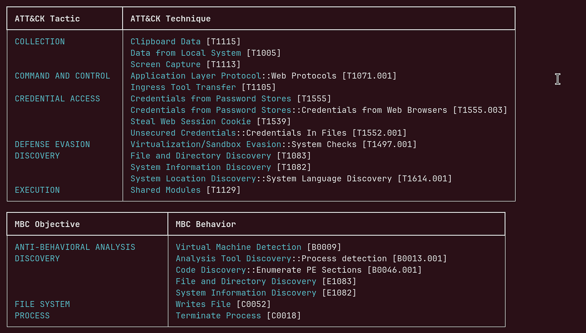

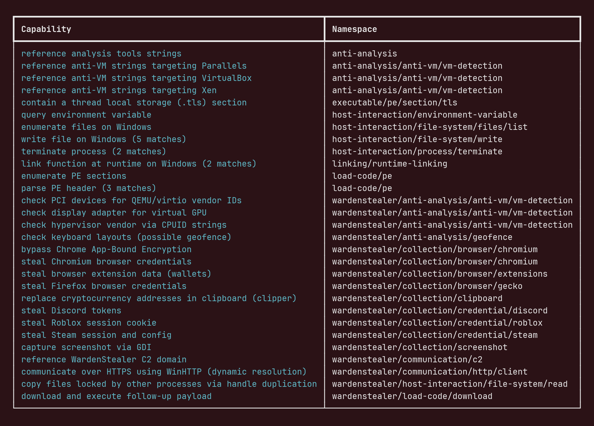
*On stage 2, all 17 string rules match. The decoder rule matches only on stage 1: in stage 2 capa doesn't recognise the decoder as a function.*

## Architecture Overview

```
java.exe (signed, Temurin/any JRE)
 └─ loads bin\jli.dll = the sample (side-loading)
     Stage 1: Rust "loader.dll", control-flow flattening + opaque predicates
     ├─ TLS callback (RVA 0xA240)
     ├─ 21 strings: lazy_init -> decoder (base64 / SplitMix64 alphabet + LCG XOR + bit-LZ)
     ├─ resolves its own APIs (LoadLibraryA / GetProcAddress)
     ├─ VirtualAlloc(0xA0400, PAGE_EXECUTE_READWRITE)
     ├─ writes a full PE into it and resolves its imports (~100 kernel32 APIs)
     └─ Sleep(INFINITE) in the main thread
         (stage 2 code runs in a new thread)
         Stage 2: Rust x64 DLL, only in memory (8 sections)
         ├─ ~480 encrypted strings, same decoder; APIs resolved lazily and cached
         ├─ VM / analysis checks -> MessageBox "yolo" (seen in my VM)
         ├─ targets: Chromium, Firefox, wallets, clipboard, Steam, Discord, Roblox, screenshots
         ├─ download and run: curl / certutil / cmd / powershell / msiexec
         └─ C2: phigerma.quest, HTTPS on port 443 (WinHTTP)
```

## IOCs

| Type | Value |
|---|---|
| SHA256 (stage 1, fake jli.dll) | `f167da5dab47670aac7271d514353f8ca5d6bd9a769116926aaad188eb499875` |
| SHA1 / MD5 (stage 1) | `29ee18b75e82d1ac673877faf4c7da2f111449b3` / `be6317861706985138852b35b296e61a` |
| SHA256 (stage 2, pe-sieve dump) | `c47f0cb5a0c51d908fbcc38be70ade963762e4f4adca8fb32f33440cb9af4376` |
| SHA1 / MD5 (stage 2, pe-sieve dump) | `d99caf0a9e2998f9a9bfb35552f7e0ab1acf3359` / `42df814fc3d85c7e8ab3ec3a4a92be7a` |
| C2 | `phigerma.quest` (HTTPS, port 443) |
| File name | `jli.dll` next to `java.exe`; internal name `loader.dll` |
| Exports | `JLI_CmdToArgs`, `JLI_GetStdArgc`, `JLI_GetStdArgs`, `JLI_InitArgProcessing`, `JLI_Launch`, `JLI_MemAlloc`, `JLI_MemFree` |
| Message box | title `yolo`, text starting with `Happy New Year! Touch some grass.` |
| Decoder constants | `0x3B42D70742E7AF28`, `0x3CC84BD037093D`, `0xE7037ED1A0B428DB`, `0x58A5AD87A4A04400`, `0x1F6818A70B374537`, `0x183DBDA06EAB4239`, `0xD0E1CA4E8334DFE9` |

The stage 2 hash is the hash of the pe-sieve output (headers and imports rebuilt). A raw dump of the same memory region gives a different hash.

## MITRE ATT&CK Mapping

| Technique | ID | Where |
|---|---|---|
| Hijack Execution Flow: DLL Side-Loading | T1574.002 | fake `jli.dll` loaded by `java.exe` |
| Obfuscated Files or Information | T1027 | flattening, opaque predicates, encrypted strings |
| Dynamic API Resolution | T1027.007 | `LoadLibraryA` / `GetProcAddress` with decoded names |
| Reflective Code Loading | T1620 | stage 2 mapped by hand into RWX memory |
| Virtualization/Sandbox Evasion: System Checks | T1497.001 | PCI, display, firmware, CPUID vendor strings |
| System Language Discovery | T1614.001 | `Keyboard Layout\Preload` (strings) |
| Application Layer Protocol: Web Protocols | T1071.001 | WinHTTP, HTTPS to `phigerma.quest` |
| Credentials from Web Browsers | T1555.003 | Chromium / Firefox files and keys (strings) |
| Steal Web Session Cookie | T1539 | `cookies.sqlite`, `.ROBLOSECURITY` (strings) |
| Clipboard Data | T1115 | clipboard APIs + wallet prefixes (strings) |
| Screen Capture | T1113 | GDI screenshot APIs (strings) |
| Ingress Tool Transfer | T1105 | `curl.exe`, `certutil.exe -urlcache` (strings) |

## Conclusion

The two stages are built with the same tools: Rust, heavy control-flow flattening, opaque predicates and one string decoder used everywhere. The flattening is what made this sample slow. Every small question ("what's in this stack slot?") needed a debugger, because the answer depended on which of a few hundred blocks ran before. The string encryption, on the other hand, gave in once I had one input/output pair from the debugger. Each layer is simple, and the key for every string is right there in the code.

The most useful step was not reading code at all. It was looking at the call stack while the message box was open. That showed a thread running from private RWX memory, and from there the whole second stage was one pe-sieve run away.

### Limitations

- In my VM the payload showed the message box and exited. The firmware check had run by then (its API cell was filled), but the same function holds other checks too (PCI devices, display adapter, memory, screen, CPUID), and I didn't single out which result made it stop. Because of this I never saw it reach the network: the C2 settings above come from the code, not from traffic.
- I know the host and the port, but I didn't recover the path, the HTTP method or the format of the data it sends.
- I didn't reverse the routine in stage 1 that turns the blobs into the stage 2 PE. I took stage 2 already decrypted, from memory and from the emulator.
- The list of targets comes from decoded strings and API names. I didn't trace each feature in the code.
- I dropped some very short decoded strings, because a wrong seed can produce one by chance.
